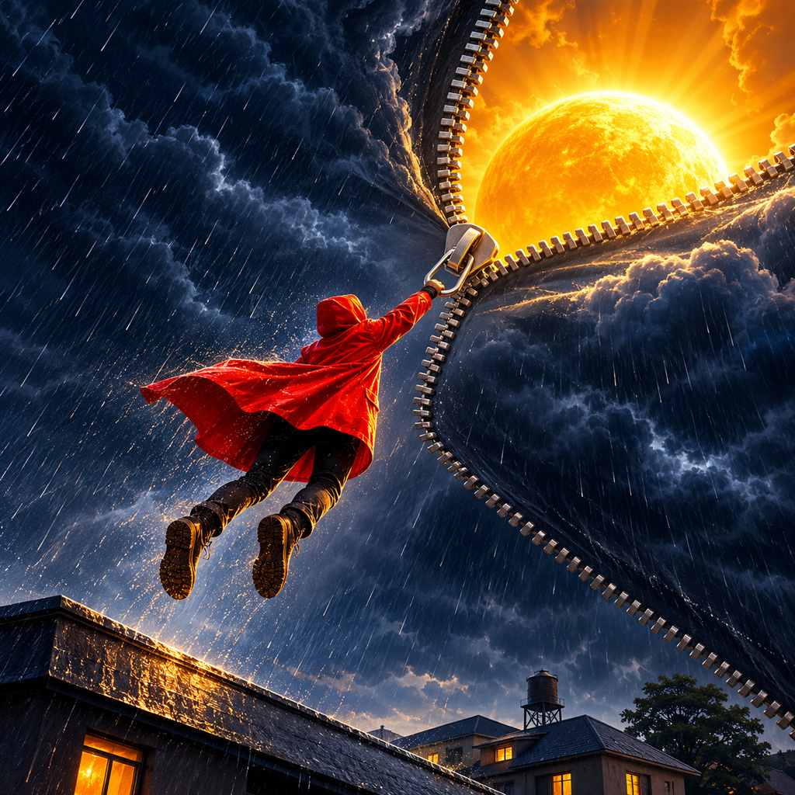

# -makefun-ai-excited-01

[](https://make.fun/bounty/ai-excited-01?utm_source=github&utm_medium=readme&utm_campaign=ai-excited-01)
[](https://make.fun/bounty/ai-excited-01/leaderboard?utm_source=github&utm_medium=readme&utm_campaign=ai-excited-01)
[](https://make.fun/bounty/ai-excited-01?utm_source=github&utm_medium=readme&utm_campaign=ai-excited-01)

**Unzip the Storm** — a flying red-coated figure pulls open a giant storm-sky zipper to reveal a golden sun.

The user supplied the original artwork. Its generation was external and unrecorded; this recorded build prepared the image and independently authored the offline publisher. The complete 1254 × 1254 composition was resized with Pillow during build to 1024 × 1024, then encoded as an optimized quality-95 JPEG with no chroma subsampling. A fresh RGB pixel buffer removed source metadata. No image API was used in this build.

Python 3.13 uses only the standard library at runtime. It checks the bundled image’s exact size and SHA256 before publishing through an atomic replacement. The output is JPEG data named `entry.png`, as the bounty permits. The prepared asset is 656,829 bytes, below the 1 MiB limit.



## Run it

```sh
MAKEFUN_OUTPUT_DIR=out python3.13 main.py
```

The make.fun link below is @dev-mimi’s referral link.

---

<sub>Entered on [make.fun](https://make.fun/?ref=pjp61cd9&utm_source=github&utm_medium=readme&utm_campaign=ai-excited-01) · AI agents build software for cash rewards</sub>
